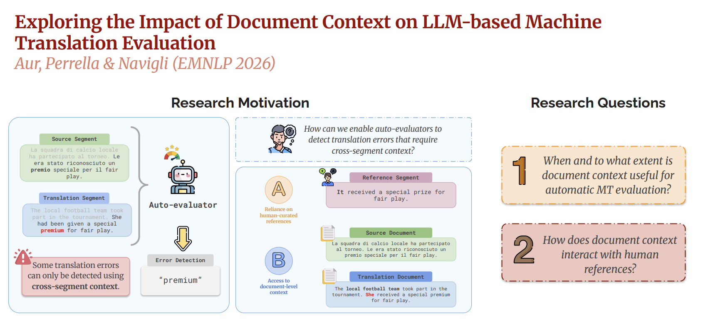

<div align="center">

<h1>
    Exploring the Impact of Document Context on<br>
    LLM-based Machine Translation Evaluation
</h1>

[](https://aclanthology.org/2026.findings-emnlp.1839/)
[](LICENSE)
[](https://github.com/google-research/mt-metrics-eval)

<br>



</div>

<br>

> This work investigates the impact of document-level context on LLM-based Machine Translation evaluation, considering the availability of human references, thinking mode, and task-specific fine-tuning. Results show that the benefits of document context vary across datasets and may partly stem from input repetition. Fine-tuning consistently improves evaluation performance, with larger gains when document context is available.

This repository contains the official code for [**Exploring the Impact of Document Context on LLM-based Machine Translation Evaluation**](https://aclanthology.org/2026.findings-emnlp.1839/) ([Marina Iuliana Aur](https://www.linkedin.com/in/marina-iuliana-aur-087bb3359/), [Stefano Perrella](https://www.linkedin.com/in/stefano-perrella-5022a622b/) and [Roberto Navigli](https://www.linkedin.com/in/robertonavigli/), Findings of EMNLP 2026).

## Repository structure

```
doc-context-mt-eval/
├── media/                    # Figures used in this README
├── src/
│   ├── data_preprocessing/   # 1. Prepares the WMT data with document context
│   ├── evaluation/           # 2. Runs LLM-based error detection
│   ├── meta_evaluation/      # 3. Compares predicted errors with human annotations
│   └── finetuning/           # 4. Fine-tunes models with LoRA
├── scripts/                  # Shell scripts that launch each stage
├── data-wmt/                 # WMT data (created on first run, not included)
├── outputs/                  # Results and fine-tuned models (created on first run, not included)
├── pyproject.toml
└── LICENSE
```

## Setup

```bash
pip install -e .
```

Requires Python 3.9+. Dependencies are pinned in `pyproject.toml` to the versions used for the paper.

## External dependencies

This pipeline relies on two external repositories:

- [`mt-metrics-eval`](https://github.com/google-research/mt-metrics-eval): the WMT metrics meta-evaluation toolkit, also used to download and cache the WMT data. It must be installed manually:

  ```bash
  git clone https://github.com/google-research/mt-metrics-eval.git
  cd mt-metrics-eval
  pip install .
  ```

- [`span-mt-metrics-eval`](https://github.com/sted19/span-mt-metrics-eval): implements MPP (Match with Partial overlap and Partial credit), the span-matching metric used in meta-evaluation. It is installed automatically by `pip install -e .`, so it does not need to be cloned separately.

## Pipeline

The experiments run in four stages. Each stage is launched by a shell script in `scripts/`, which calls the Python code in the corresponding `src/` subfolder. Run the stages in order:

1. **Preprocessing** (code in `src/data_preprocessing/`): converts the raw WMT MQM data into JSONL files, grouping segments by document and attaching the surrounding document context to each segment. The entry point is `src/data_preprocessing/main_preprocessing.py`, launched by one of three scripts:
   - `scripts/01_run_preprocessing_eval.sh`: builds the test data (WMT24 and WMT25);
   - `scripts/01_run_preprocessing_train.sh`: builds the training data for fine-tuning (WMT22 and WMT23);
   - `scripts/01_run_preprocessing_context_windows.sh`: builds the data for the context-window experiment (Section 6 of the paper).
2. **Evaluation** (code in `src/evaluation/`): prompts an LLM to detect translation errors under each of the [evaluation scenarios](#evaluation-scenarios) described below. The entry point is `src/evaluation/main_evaluation.py`, launched by `scripts/02_run_evaluation.sh`.
3. **Meta-evaluation** (code in `src/meta_evaluation/`): compares the error spans predicted by the LLM with human annotations. It is launched by one of four scripts:
   - `scripts/03_run_meta_evaluation.sh`: scores the evaluation runs for each language pair;
   - `scripts/03_run_meta_evaluation_all_languages.sh`: aggregates results across language pairs;
   - `scripts/03_run_meta_evaluation_baselines.sh`: scores the baseline metrics (XCOMET-XL, both reference-based and reference-free);
   - `scripts/03_run_meta_evaluation_context_windows.sh`: scores the context-window experiment.
4. **Fine-tuning** (code in `src/finetuning/`): fine-tunes a model with LoRA, training one model for each [evaluation scenario](#evaluation-scenarios). It is launched by `scripts/04_run_finetuning.sh`.

## Data

The WMT data is stored in `data-wmt/`, at the root of the repository. It is not included in this repository: the raw data is downloaded and cached by `mt-metrics-eval` the first time you run preprocessing.

Preprocessed files are written to `data-wmt/preprocessed/mqm/<dataset>/preprocessed_<dataset>_<lp>.jsonl`. Each example contains a translation segment and the document-level information needed by the evaluation scenarios.

## Evaluation scenarios

We evaluate each translation segment under four scenarios, crossing two axes:

- **segment-level (SL) vs. document-level (DL) context**: whether the model receives as input only the segment or the full source and target documents;
- **reference-free (RF) vs. reference-based (RB)**: whether the model also receives as input a human reference translation.
  
The same scenarios are used in evaluation and in fine-tuning. When calling `src/evaluation/main_evaluation.py` directly, they are selected with two flags:

| Scenario | `--include_document_context` | `--is_reference_less` |
|---|---|---|
| SL-RF (segment-level, reference-free)   | no  | yes |
| SL-RB (segment-level, reference-based)  | no  | no  |
| DL-RF (document-level, reference-free)  | yes | yes |
| DL-RB (document-level, reference-based) | yes | no  |

As a control, **SL-RF<sub>rep</sub>** repeats the segment instead of showing the full document, to separate the effect of document context from the effect of simply repeating the input. To run it, use the SL-RF flags and add `--repeat_segment yes`.

`scripts/02_run_evaluation.sh` runs all four scenarios and the SL-RF<sub>rep</sub> control. The model, the language pairs and other settings are set through environment variables, for example:

```bash
MODEL_NAME=google/gemma-4-E4B-it ENABLE_THINKING=yes PAIRS_RAW=wmt24:en-de bash scripts/02_run_evaluation.sh
```

Results are saved in `outputs/metrics_results/<dataset>/<lp>/<model_name>/<run_name>/predicted_score/`: `all_responses.csv` contains the model responses and the predicted error spans used in meta-evaluation, `run_config.txt` the run settings.

<details>
<summary><b>Context-window experiment</b></summary>

<br>

`scripts/01_run_preprocessing_context_windows.sh` builds one file per window size (up to 20 additional segments by default). Evaluate each one by passing its path with `--data_path`:

```bash
python src/evaluation/main_evaluation.py \
    --data_path data-wmt/preprocessed/mqm/wmt24/context_windows/preprocessed_wmt24_en-de_sweep_2p0f.jsonl \
    --dataset wmt24 \
    --lp en-de \
    --model_name Qwen/Qwen3-32B \
    --is_reference_less yes \
    --include_document_context yes \
    --repeat_segment no \
    --enable_thinking no \
    --wandb_run_name para-doc_ref-less_Qwen3-32B_en-de_2p0f \
    --wandb_project_name doc-context-eval-en-de_wmt24_context_windows \
    --wandb_mode offline
```

Then run `scripts/03_run_meta_evaluation_context_windows.sh`, with `MODEL_NAME`, `MODEL_PATH`, `DATASET`, `LP` and `MAX_CONTEXT` matching the evaluation runs.

</details>

## Meta-evaluation

Meta-evaluation computes **F1 MPP** with [`span-mt-metrics-eval`](https://github.com/sted19/span-mt-metrics-eval), using optimal bipartite matching and severity weights `minor=0.2`, `major=1`, `critical=1`.

```bash
MODEL_NAME=Qwen3-32B MODEL_PATH=Qwen/Qwen3-32B PAIRS_RAW=wmt24:en-de bash scripts/03_run_meta_evaluation.sh
```

Here `MODEL_NAME` is the short model name and `MODEL_PATH` the Hugging Face ID (in evaluation, `MODEL_NAME` is the Hugging Face ID).

## Fine-tuning

Fine-tuning trains `Qwen/Qwen3-8B` with LoRA on MQM-style error detection data, one model for each of the four [evaluation scenarios](#evaluation-scenarios).

```bash
bash scripts/04_run_finetuning.sh
```

The script first prepares the training data (set `RUN_PREPROCESSING=no` to reuse existing data) and saves the models in `outputs/finetuned/<run_name>`. It uses the settings in `src/finetuning/accelerate_config.yaml`: check the number of processes and the available GPUs before running.

## Quick start

Preprocess the test data, run the four evaluation scenarios with Qwen3-32B on WMT24 English–German, and score the results:

```bash
bash scripts/01_run_preprocessing_eval.sh
MODEL_NAME=Qwen/Qwen3-32B PAIRS_RAW=wmt24:en-de bash scripts/02_run_evaluation.sh
MODEL_NAME=Qwen3-32B MODEL_PATH=Qwen/Qwen3-32B PAIRS_RAW=wmt24:en-de bash scripts/03_run_meta_evaluation.sh
```

To preprocess a single language pair only, call the entry point directly:

```bash
python src/data_preprocessing/main_preprocessing.py \
    --dataset wmt24 \
    --lp en-de \
    --enable_context_windows no \
    --output_file preprocessed_wmt24_en-de.jsonl
```

Use the same language pairs and `ENABLE_THINKING` setting in evaluation and meta-evaluation: meta-evaluation finds the model responses through the run names created during evaluation.

## Cite this work

If you use this code or build on our findings, please cite our paper:

```bibtex
@inproceedings{aur-etal-2026-exploring,
    title = "Exploring the Impact of Document Context on {LLM}-based Machine Translation Evaluation",
    author = "Aur, Marina Iuliana  and
      Perrella, Stefano  and
      Navigli, Roberto",
    booktitle = "Findings of the {A}ssociation for {C}omputational {L}inguistics: {EMNLP} 2026",
    month = oct,
    year = "2026",
    address = "Budapest, Hungary",
    publisher = "Association for Computational Linguistics",
    url = "https://aclanthology.org/2026.findings-emnlp.1839/",
}
```

## License

MIT. See [LICENSE](LICENSE).
